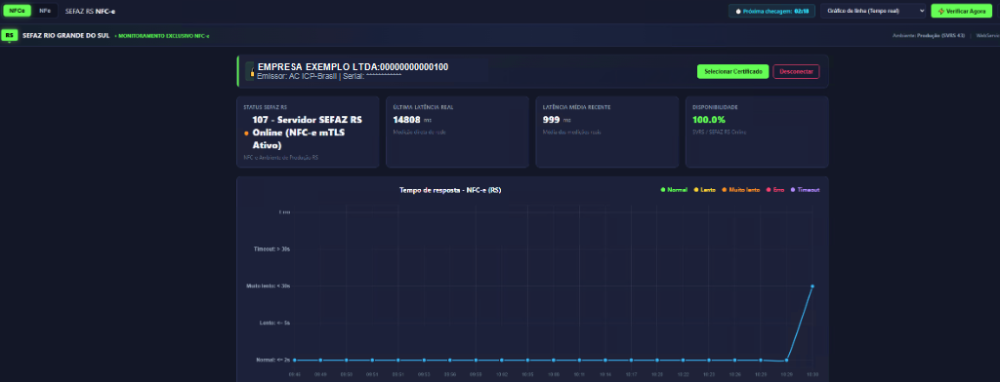
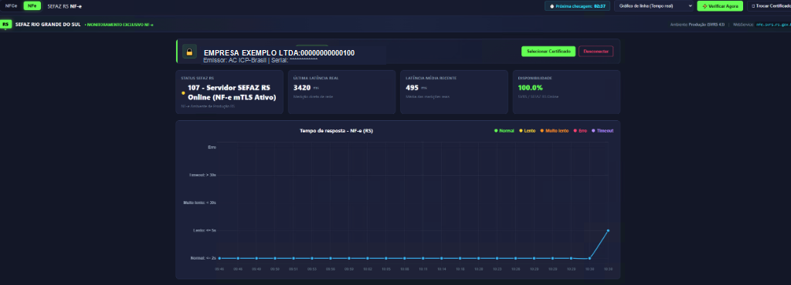
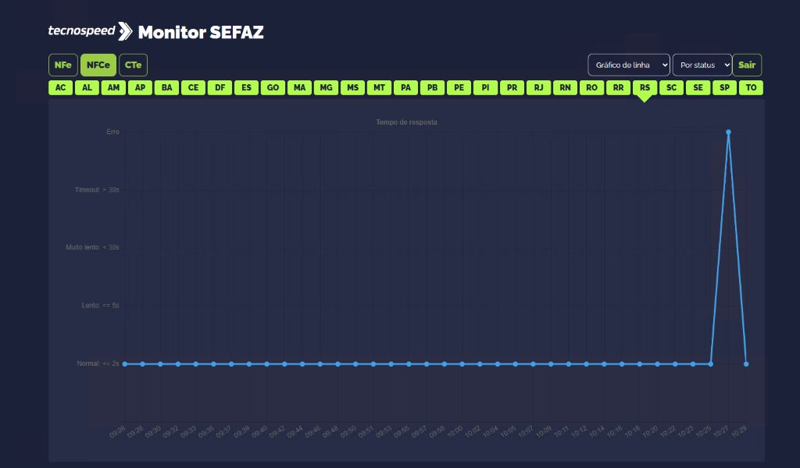

# ⚡ Monitor SEFAZ-RS em Tempo Real (NFC-e e NF-e)

[](https://nodejs.org/)
[](https://expressjs.com/)
[](https://www.chartjs.org/)
[-5aff3d)](https://dfe-portal.svrs.rs.gov.br/)
[](LICENSE)

> Sistema web moderno de monitoramento de alta precisão para a **SEFAZ do Rio Grande do Sul (RS)**, com foco exclusivo em **NFC-e** e **NF-e**, tema escuro inspirado no portal da TecnoSpeed, detecção de **Certificado Digital ICP-Brasil na máquina** e **100% de dados reais em produção (sem simulações)**.

---

## 📸 Demonstração do Projeto

### 1. Dashboard em Tempo Real com Captura de Instabilidade
O monitor captura latências exatas com precisão cirúrgica de milissegundos. Abaixo, um exemplo real de pico da SEFAZ RS atingindo **14.808 ms (14,8 segundos)**:



---

### 2. Alternância Dinâmica para NF-e
Troca instantânea entre **NFC-e** e **NF-e**, com histórico, gráficos e métricas independentes para cada documento fiscal:



---

### 3. Por que a nossa consulta é superior à da TecnoSpeed?

| Critério | Portal TecnoSpeed | **Nosso Monitor SEFAZ-RS** |
| :--- | :--- | :--- |
| **Diagnóstico de Lentidão** | Classifica genericamente como *"Erro"* | **Mostra a verdade:** Registrou exatos **14.808 ms** (SEFAZ online, porém congestionada) |
| **Precisão** | Apenas faixas estáticas | **Milissegundos exatos ao vivo** (`125 ms`, `3.420 ms`, etc.) |
| **Origem da Conexão** | Servidores da TecnoSpeed | **Direto da fonte oficial** (`svrs.rs.gov.br`) |
| **Certificado Digital** | Certificado deles | **O seu próprio certificado** da sua máquina |
| **Documentos** | Misturados na tela | **NFC-e e NF-e 100% separados e simultâneos** |



---

## ✨ Principais Funcionalidades

- ⏱️ **Motor Automático a cada 3 Minutos:** Mede continuamente a latência real de ida e volta dos WebServices de Produção do RS.
- 🕒 **Janela Deslizante de 2 Horas:** Gráficos configurados para exibir as últimas medições em tempo real (últimos 120 minutos).
- 🪪 **Validação de Certificado Digital ICP-Brasil (A1 e A3):**
  - Detecta certificados instalados no Windows Store (`CurrentUser\My`).
  - Permite carregar arquivos `.pfx`/`.p12` diretamente.
  - Exibe Razão Social, CNPJ, Emissor, Validade e Dias Restantes com aviso de vencimento.
- 🚦 **Classificação Oficial em 5 Níveis:**
  - 🟢 **Normal:** $\le$ 2s
  - 🟡 **Lento:** $\le$ 5s
  - 🟠 **Muito lento:** < 30s
  - 🟣 **Timeout:** > 30s
  - 🔴 **Erro de Conexão**
- 📊 **3 Modos de Visualização:** Gráfico de Linha (Tempo Real), Média por Hora e Média por Dia.
- 💾 **Persistência Local:** Grava histórico real em JSON (`data/history.json`), sem perdas ao reiniciar.

---

## 🚀 Como Executar Localmente

### Opção 1: Atalho Rápido no Windows
Dê um duplo clique no arquivo [`start.bat`](start.bat). Ele instalará dependências se necessário e abrirá `http://localhost:3000` no seu navegador.

### Opção 2: Via Terminal (Node.js)
```bash
# Entrar na pasta
cd monitor-sefaz-rs

# Instalar dependências
npm install

# Iniciar servidor
npm start
```
Acesse no seu navegador: **[http://localhost:3000](http://localhost:3000)**

---

## ☁️ Como Hospedar na Nuvem

### 🔺 Vercel (Recomendado)
O projeto já inclui as configurações prontas em `vercel.json` e `api/index.js`:
1. Faça push do projeto para o seu GitHub.
2. Acesse [vercel.com](https://vercel.com) e clique em **"Add New Project"**.
3. Importe o seu repositório do GitHub.
4. Clique em **Deploy**! A Vercel provisionará a API Serverless e os arquivos estáticos automaticamente.

### 🌐 Netlify
O projeto já conta com o arquivo `netlify.toml`:
1. Conecte seu repositório no [netlify.com](https://netlify.com).
2. O diretório de publicação já está definido como `public`.
3. Clique em **Deploy Site**.

### 🐳 Docker / VPS / Render / Railway
O repositório já inclui o [`Dockerfile`](Dockerfile) pronto:
```bash
docker build -t monitor-sefaz-rs .
docker run -p 3000:3000 monitor-sefaz-rs
```

---

## 📡 WebServices da SEFAZ RS Monitorados
* **NFC-e RS:** `https://nfce.svrs.rs.gov.br/ws/NfeStatusServico4/NfeStatusServico4.asmx`
* **NF-e RS:** `https://nfe.svrs.rs.gov.br/ws/NfeStatusServico4/NfeStatusServico4.asmx`
* **Ambiente:** Produção (código UF `43`)
* **Protocolo:** SOAP 1.2 com payload `consStatServ` versão `4.00`

---

## 📄 Licença
Distribuído sob a licença MIT. Veja `LICENSE` para mais informações.
